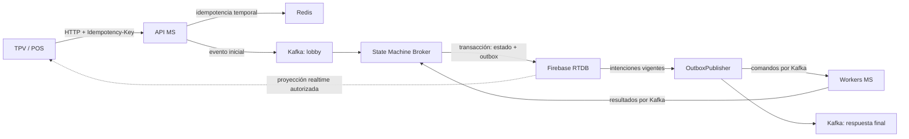

# LeenusTechs CIA — State Machine Broker

`leenustechs-cia-state` orquesta workflows transaccionales de CIA con **Java 21,
Spring Boot, Kafka y Firebase Realtime Database (RTDB)**. Persiste las transiciones
junto con sus publicaciones pendientes, coordina etapas secuenciales y paralelas,
y recupera ejecuciones cuyos trabajadores no responden.

Esta guía sigue la organización y terminología del [wiki del proyecto](https://deepwiki.com/renelee121/leenustechs-cia-state):
visión general, componentes, contratos, garantías y operación. Los nombres de
tópicos, propiedades y comportamientos descritos aquí corresponden al código de
este repositorio.

## Visión general

El sistema CIA procesa solicitudes del TPV/POS de forma asíncrona. El wiki ubica
sus responsabilidades en estas capas:

| Componente | Responsabilidad |
| --- | --- |
| TPV/POS y perímetro | Cliente HTTP, acceso mediante WAF/Kong/ELB y lectura realtime autorizada. |
| API MS (`leenustechs-cia-api`) | Validación HTTP, idempotencia temporal en Redis y publicación inicial en Kafka. |
| State Machine Broker (**este repositorio**) | Orquestación, estado durable, Transactional Outbox y reconciliación. |
| Workers MS | Lógica de negocio de cada paso; reciben comandos y publican resultados. |
| Kafka y Firebase RTDB | Transporte de eventos, persistencia del workflow y soporte para lectura realtime. |



El contrato de entrada documentado por el wiki es
`POST /config-api/v1/activation/login` con `Idempotency-Key`. La API responde
**202 Accepted después del ACK de publicación en Kafka**. Ese ACK confirma la
aceptación del evento de entrada; no confirma que el workflow ya exista en
Firebase ni que el login haya terminado.

El endpoint HTTP y Redis pertenecen al API MS. Este servicio consume eventos de
Kafka y no necesita Redis para ejecutar sus workflows. La proyección y los
permisos reales de lectura del TPV dependen del despliegue.

## State Machine Broker

### Componentes internos

| Componente | Responsabilidad |
| --- | --- |
| `KafkaListenerAdapter` | Consume los cuatro tópicos de entrada y valida el origen del evento. |
| `CommandDispatcherServiceImpl` | Enruta el comando hacia un `EventOperation` registrado. |
| `LoginUseCase` | Declara las etapas del workflow `LOGIN`, actualmente registrado. |
| `EventStateServiceImpl` | Aplica transiciones, plazos y publicaciones pendientes en una transacción RTDB. |
| `StagePayloadAggregator` | Combina resultados contra la entrada de la etapa de forma determinista. |
| `FirebaseEventStateRepository` | Implementa transacciones, consultas indexadas y codificación del estado. |
| `OutboxPublisher` | Confirma la intención vigente, publica en Kafka y registra su entrega. |
| `WorkflowReconciler` | Descubre etapas vencidas y asigna plazos a ejecuciones antiguas. |
| `DefaultErrorHandler` | Aplica reintentos limitados y recuperación hacia `<inputTopic>.DLT`. |

### Workflow Login

La secuencia declarada en [LoginUseCase.java](src/main/java/mx/com/leenustechs/ciaState/business/useCases/LoginUseCase.java) es:

| Etapa (`stageIndex`) | Pasos | Ejecución |
| --- | --- | --- |
| 0 | `SECURITY` | Secuencial |
| 1 | `STUDENTS`, `ASSETS`, `PREFERENCES`, `ROLES` | Paralela |
| 2 | `MODULES` | Secuencial |

Una etapa paralela avanza cuando todos sus pasos están completos y sus resultados
persistidos pueden combinarse. El merge usa la entrada de la etapa como base,
conserva cambios independientes y rechaza escrituras incompatibles sobre la
misma ruta con `INVALID_STAGE_RESULTS`. La combinación sigue el orden declarado
del workflow, independientemente del orden de llegada de las respuestas.

```text
PROCESSING → COMPLETED
           → FAILED
```

## Contratos y mensajes

### Envelope Kafka

Ejemplo de respuesta de un worker:

```json
{
  "transactionId": "login-123",
  "producer": "SECURITY",
  "command": "LOGIN",
  "payload": {"userId": "example"},
  "eventId": "security-response-123",
  "executionId": "login-123",
  "stageIndex": 0,
  "outcome": "SUCCESS"
}
```

| Campo | Contrato |
| --- | --- |
| `transactionId` | Identifica el workflow y se usa como clave Kafka y nodo RTDB. |
| `producer` | `CIA_API` para la entrada; `CIA_STATE` para comandos y respuesta final; nombre del `StepType` para resultados de workers. |
| `command` | Operación que enruta el dispatcher; el workflow implementado actualmente es `LOGIN`. |
| `payload` | Entrada, resultado de un paso o resultado final, según el mensaje. |
| `eventId` | Identificador estable para deduplicación; las publicaciones de este servicio también lo incluyen en el header `event-id`. |
| `executionId` | Correlaciona la ejecución; los workers deben devolver el valor recibido. |
| `stageIndex` | Identifica la etapa; los workers deben devolver el índice recibido. |
| `outcome` | `SUCCESS` o `FAILURE`; la respuesta final usa este campo para expresar el resultado. |

Las entradas de error y deadletter fuerzan `outcome=FAILURE`. Por compatibilidad
se acepta el envelope original de cuatro campos: `transactionId`, `producer`,
`command` y `payload`. Si faltan `executionId` y `stageIndex`, se usan el ID de
transacción y la etapa del worker, respectivamente. Una ejecución con un
`executionId` distinto del ID de transacción requiere que sus respuestas lo
incluyan. Solo cuando falta `outcome` se reconocen los indicadores de error
legados: `exception` o la pareja `error_code`/`error_message` en el payload.

Los identificadores se validan para su uso en Firebase; también se comprueban la
correlación del comando y la ejecución, el worker y la etapa activa.

### Tópicos Kafka

Los nombres completos están definidos en [KafkaTopics.java](src/main/java/mx/com/leenustechs/ciaState/models/constants/KafkaTopics.java).

| Tópico | Uso del State Machine |
| --- | --- |
| `leenustechs-cia-lobby` | Entrada inicial de la API (`producer=CIA_API`). |
| `leenustechs-cia-response` | Entrada de resultados de workers. |
| `leenustechs-cia-deadletter` | Entrada de fallos informados por workers. |
| `leenustechs-cia-failure-response` | Entrada de fallos controlados. |
| `leenustechs-cia-security` | Comandos a `SECURITY`. |
| `leenustechs-cia-students` | Comandos a `STUDENTS`. |
| `leenustechs-cia-assets` | Comandos a `ASSETS`. |
| `leenustechs-cia-preferences` | Comandos a `PREFERENCES`. |
| `leenustechs-cia-roles` | Comandos a `ROLES`. |
| `leenustechs-cia-modules` | Comandos a `MODULES`. |
| `leenustechs-cia-response-final` | Publicación del resultado final del workflow. |
| `<inputTopic>.DLT` | Publicación de mensajes que no pudieron procesarse. |

Los cuatro primeros son los únicos tópicos consumidos por este servicio. Los
`.DLT` generados por el manejador no son los tópicos de fallos de workers y no se
consumen ni se reproducen automáticamente.

## Estado durable y Transactional Outbox

Cada workflow se persiste bajo una raíz configurable:

```text
/workflows/{transactionId}
```

| Campos | Contenido |
| --- | --- |
| `transactionId`, `executionId`, `producer`, `command` | Identidad y origen del workflow. |
| `status`, `currentStage`, `steps`, `completedStages` | Estado actual y avance de etapas. |
| `initialPayload`, `payload`, `stepResults`, `result` | Entrada original, contexto de la etapa, resultados parciales y resultado final. |
| `stageDeadlineAt` | Vencimiento de la etapa activa, expresado en milisegundos de época. |
| `pendingOutbox`, `outboxPending` | Publicaciones pendientes e indicador para el escaneo indexado. |
| `createdAt`, `updatedAt` | Tiempos de creación y actualización. |

En una sola transacción RTDB se registra un resultado aceptado, se avanza o
termina el workflow y se escriben sus publicaciones pendientes. El callback de
Firebase puede repetirse: **nunca se publica en Kafka dentro de él**.

El publisher consulta `outboxPending == true`, confirma mediante una transacción
que la intención sigue vigente, envía el evento y espera el ACK antes de eliminar
esa intención. Un resultado de worker aceptado también retira su comando
pendiente, porque prueba su ejecución. Al cerrar el workflow se cancelan los
comandos restantes y se conserva únicamente la notificación final pendiente.

Firebase puede eliminar hijos vacíos/nulos y convertir objetos con claves
numéricas en arrays. Para conservar el contenido, el adaptador guarda JSON
canónico junto con proyecciones nativas RTDB. `stepResults` usa un wrapper
`present`/`json`, con `payload` nativo cuando es representable; el outbox conserva
`eventJson` y el instante `enqueuedAt` cuando existe. Las proyecciones incompatibles
con los tipos o límites de ruta/profundidad se omiten sin perder el JSON canónico.
Las rutas y los metadatos obligatorios se validan con el SDK; los límites de tamaño
de escritura del servidor siguen aplicando.

Los registros corruptos se omiten individualmente y se reportan por clave, sin
registrar payloads. Los cursores avanzan sobre filas leídas, incluso si una página
entera es inválida. Los datos originales se conservan para reparación; una caída
de Firebase se trata como un fallo de consulta que debe reintentarse.

## Garantías, idempotencia y límites

- **Atomicidad local:** estado y outbox se confirman juntos en el nodo RTDB.
- **Entrega al menos una vez (at-least-once):** un reinicio después del ACK de Kafka
  y antes de registrar su confirmación en Firebase puede repetir una publicación.
  Varias instancias también pueden publicar la misma intención. Los consumidores
  deben deduplicar por `eventId` antes de aplicar efectos; la idempotencia del
  productor Kafka no sustituye esa deduplicación entre reinicios.
- **Creación idempotente del workflow:** repetir la entrada `CIA_API` con el mismo
  ID, comando, ejecución y contenido no reinicia la transacción. Los estados
  `COMPLETED` y `FAILED` no se reabren; una nueva ejecución intencional necesita
  otro `transactionId`.
- **Cancelación de pendientes:** una captura antigua del outbox no autoriza por
  sí sola el envío. Un intento autorizado justo antes del cierre todavía puede
  terminar; el worker debe comprobar la vigencia cuando sus efectos requieran
  cancelación. Los efectos ya iniciados no pueden retirarse desde RTDB.
- **Vencimiento de ejecución y retención son distintos:** una etapa vencida falla,
  pero no se borran automáticamente el workflow ni su historial.

La idempotencia HTTP descrita en el wiki corresponde a la API: Redis mantiene una
ventana fija de 30 segundos desde el primer claim. La ventana de Redis y la
idempotencia durable por `transactionId` son mecanismos distintos; no hay
exactly-once global. Los detalles de TTL, espera de ACK y scripts Lua deben consultarse en la
documentación del API MS. Un nuevo ID emitido fuera de esa ventana representa
otro workflow para este broker.

## Operación

### Requisitos y autenticación

| Requisito | Versión o mecanismo |
| --- | --- |
| Java | 21 |
| Maven | `>= 3.9.12` y `< 4` |
| Spring Boot / Spring Cloud | `4.0.9` / `2025.1.1`, con el verificador de compatibilidad activo |
| Kafka | SASL_SSL / SCRAM-SHA-512 |
| Firebase RTDB | URL de base de datos y Google Application Default Credentials (ADC) |

| Variable | Uso |
| --- | --- |
| `FIREBASE_DATABASE_URL` | URL de Firebase RTDB, obligatoria. |
| `GOOGLE_APPLICATION_CREDENTIALS` | Ruta a un archivo de credenciales para ADC cuando no se usa identidad de workload. |
| `KAFKA_BOOTSTRAP_SERVERS` | Brokers Kafka. |
| `KAFKA_USERNAME`, `KAFKA_PASSWORD` | Credenciales SASL. |
| `KAFKA_GROUP_ID` | Grupo consumidor; default `cia-state`. |

En desarrollo, el archivo de credenciales debe estar fuera del repositorio. En
cloud puede usarse identidad de workload. No se deben versionar credenciales.

La raíz RTDB se configura mediante `firebase.rtdb.workflow-path` (default
`workflows`) y la espera de operaciones mediante
`firebase.rtdb.operation-timeout-seconds` (default `10`). Los nombres
`FIREBASE_WORKFLOW_PATH` y `FIREBASE_OPERATION_TIMEOUT_SECONDS` utilizados en
algunas guías requieren un enlace explícito si el despliegue decide conservarlos,
por ejemplo en un archivo de configuración externo:

```properties
firebase.rtdb.workflow-path=${FIREBASE_WORKFLOW_PATH:workflows}
firebase.rtdb.operation-timeout-seconds=${FIREBASE_OPERATION_TIMEOUT_SECONDS:10}
```

### Índices y permisos

Añadir estos nombres a los índices existentes de la raíz configurada, conservando
las reglas de acceso del despliegue:

```json
{
  "rules": {
    "workflows": {
      ".indexOn": ["outboxPending", "stageDeadlineAt", "status"]
    }
  }
}
```

Provisionar los tópicos anteriores y un `<inputTopic>.DLT` por cada tópico de
entrada. El servicio necesita leer sus entradas y publicar comandos, resultados
finales y DLT. El TPV debería leer una proyección sanitizada y autorizada del
workflow; no requiere acceso al nodo completo, a `pendingOutbox` ni a payloads
internos.

### Plazos y reconciliación

| Propiedad Spring | Default | Efecto |
| --- | --- | --- |
| `workflows.stage-timeout-seconds` | `300` | Presupuesto de ejecución de cada etapa. |
| `workflows.reconciliation.enabled` | `true` | Activa los escaneos de reconciliación. |
| `workflows.reconciliation.poll-interval-ms` | `1000` | Intervalo del escaneo de etapas vencidas. |
| `workflows.reconciliation.legacy-poll-interval-ms` | `30000` | Intervalo del descubrimiento de workflows antiguos. |
| `workflows.reconciliation.batch-size` | `100` | Máximo de filas por página de reconciliación. |
| `spring.task.scheduling.pool.size` | `3` | Permite ejecutar outbox, vencimientos y descubrimiento sin compartir un único hilo. |

El plazo se calcula al entrar en la etapa e incluye la espera de entrega de
comandos. Los resultados parciales no lo extienden. Al avanzar se asigna uno
nuevo. Las respuestas recibidas después del vencimiento no completan la etapa.

La reconciliación comprueba de nuevo el estado en una transacción, marca como
error los pasos que esperaban, cambia a `FAILED`, cancela comandos y encola
`STAGE_TIMEOUT` como respuesta final. La detección puede demorarse por backlog o
por una caída de la base de datos. Los workflows antiguos sin plazo reciben un
período de gracia completo desde su descubrimiento, no desde sus timestamps
históricos. Mantener sincronizados los relojes de las instancias.

Desactivar la reconciliación detiene los escaneos de fondo. Las entradas siguen
respetando los plazos persistidos y el outbox aplaza comandos vencidos; la
operación normal requiere mantener la reconciliación habilitada.

### Outbox, timeouts y recuperación Kafka

| Propiedad Spring | Default | Efecto |
| --- | --- | --- |
| `outbox.enabled` | `true` | Activa el publicador de pendientes. |
| `outbox.poll-interval-ms` | `1000` | Espera entre lotes. |
| `outbox.batch-size` | `100` | Máximo de workflows por página del outbox. |
| `outbox.send-timeout-seconds` | `15` | Espera del future de publicación. |
| `kafka.producer.max-block-ms` | `1000` | Límite de espera síncrona de enqueue. |
| `kafka.producer.delivery-timeout-ms` | `10000` | Límite de entrega del productor. |
| `kafka.producer.request-timeout-ms` | `5000` | Timeout de petición al broker. |
| `kafka.producer.linger-ms` | `0` | Espera para agrupar envíos. |

El timeout de entrega debe cubrir petición más linger. La espera síncrona, la
espera del future y los tiempos de las transacciones Firebase son independientes;
ninguno de esos valores limita por sí solo la duración del lote completo. La
publicación es secuencial y debe dimensionarse con mediciones de carga.

Los fallos de procesamiento recuperables tienen hasta tres reintentos con
backoff de 1/2/4 segundos. Argumentos inválidos y errores de deserialización van
directamente a DLT. La recuperación solo termina cuando se confirma el envío a
DLT. Su body conserva el mensaje fallido; los permisos y la retención deben
adecuarse a ese contenido. La reparación o reproducción de DLT requiere un
proceso externo.

### Métricas

Micrometer registra los siguientes medidores mediante Actuator. La exposición
HTTP predeterminada de endpoints no se amplía; el acceso de monitorización debe
configurarse en el despliegue.

| Medidor | Significado |
| --- | --- |
| `cia.outbox.delivery.success` | Entregas con ACK de Kafka y confirmación del outbox completada. |
| `cia.outbox.delivery.failures`, `cia.outbox.delivery.timeouts` | Intentos fallidos, incluidos preflight/confirmación; timeouts es un subconjunto. |
| `cia.outbox.delivery.duration`, `cia.outbox.poll.duration` | Tiempo de intento de envío/confirmación y del lote completo, respectivamente. |
| `cia.outbox.scan.rejected`, `cia.outbox.scan.failures` | Filas corruptas y consultas no disponibles. |
| `cia.outbox.page.pending.workflows`, `cia.outbox.page.pending.events` | Pendientes observados en la última página sana consultada. |
| `cia.outbox.page.oldest.age` | Edad en segundos del evento con timestamp conocido más antiguo de esa página. |
| `cia.outbox.page.unknown.timestamps` | Eventos de esa página sin `enqueuedAt` conocido. |
| `cia.workflows.reconciliation` | Intentos con resultado changed/unchanged/failed, por tipo de escaneo. |
| `cia.workflows.reconciliation.scan.rejected`, `cia.workflows.reconciliation.scan.failures` | Filas corruptas y consultas no disponibles de reconciliación. |

Los gauges de página llevan `scope=last_scan_page`: no representan el backlog
global y pueden describir eventos ya entregados después de la lectura. Los
timestamps desconocidos se cuentan aparte y no participan en el cálculo de edad.
Los IDs de transacción y evento no se usan como etiquetas de métricas.

## Desarrollo y validación

Desde la raíz del repositorio, con Java 21 y Maven disponibles:

```sh
mvn verify
```

Para ejecutar el servicio, configurar las credenciales y conexiones anteriores:

```sh
mvn spring-boot:run
```

La suite valida el contexto real de Spring con Firebase simulado y listeners
Kafka detenidos, mantiene activo el verificador de compatibilidad y prueba el
rechazo de combinaciones incompatibles. También cubre transiciones atómicas,
respuestas duplicadas y concurrentes, agregación paralela, cancelaciones,
reinicios, plazos con reloj controlado, reconciliación y codec con los validadores
del SDK de Firebase.

La conexión real a Kafka/Firebase, los contratos de los workers, la proyección
consumida por el TPV y el destino operativo de la respuesta final requieren una
validación end-to-end en el entorno del sistema. La cobertura de pruebas no
sustituye esa comprobación ni las pruebas de carga.

Antes de desplegar: preparar tópicos e índices, confirmar la deduplicación en
workers/consumidores y validar un login en un namespace de desarrollo. Antes de
actualizar, drenar workflows activos. Los estados legados pueden leerse, pero las
transiciones interrumpidas o envíos perdidos de versiones sin outbox no se
reconstruyen automáticamente.
